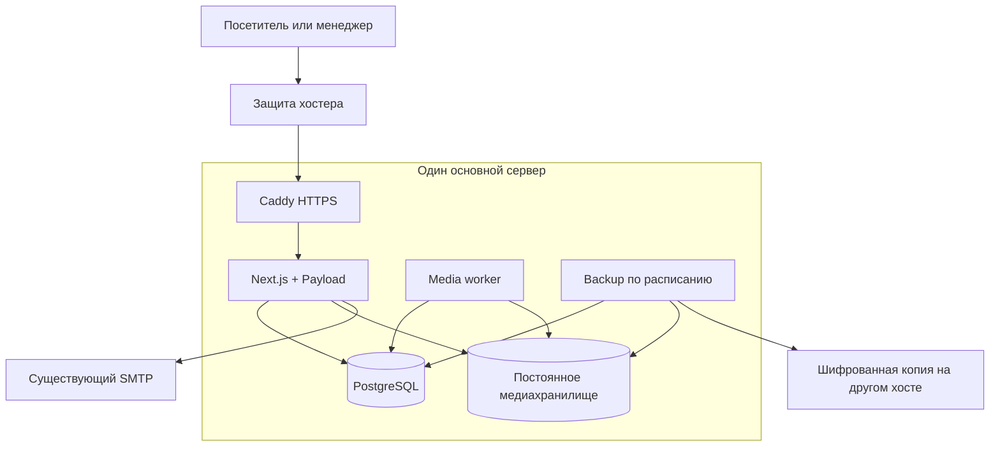
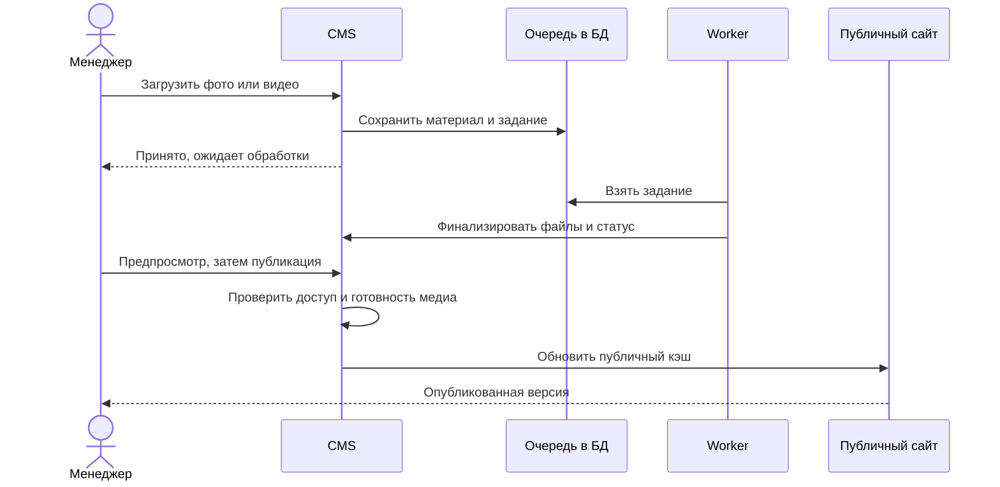
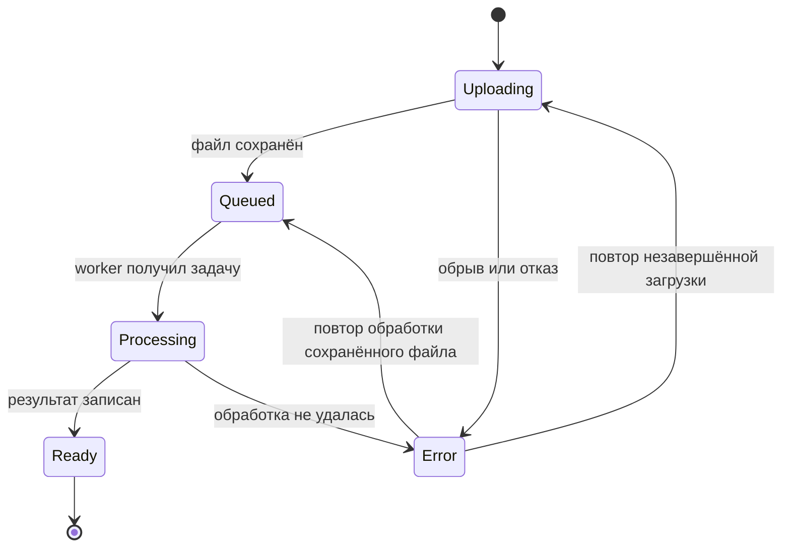

# ПромФормаТех: минимальная версия сайта и админки - Plan

## Goal Capsule

- **Цель:** менеджер без опыта наполнения сайтов самостоятельно обновляет страницы и публикует продукцию и проекты с фотографиями и видео.
- **Способ:** Next.js + Payload на одном сервере, независимые резервные копии (KTD1, KTD2, KTD7).
- **Приоритет требований:** решения владельца и R1–R19 → технические решения KTD → этапы U1–U8 → справочные источники.
- **Граница поручения:** этот документ задаёт будущую реализацию. Подготовка плана не разрешает развёртывание, покупки услуг, переключение домена или изменение действующего сайта.
- **Профиль реализации:** сначала проверяем удобство редактора на одной карточке, затем переносим остальные сценарии. До публичного запуска закрываем проверки сохранности данных и доступа.
- **Завершение:** разработчик готовит проверяемую версию, владелец и менеджер принимают её по Verification Contract. Владелец отдельно разрешает переключение действующего домена.

---

## Product Contract

### Summary

Перенести существующий корпоративный сайт на поддерживаемый стек и настроить Payload под работу менеджера.
Объём — выставочная продукция, услуги, проекты, страницы компании и заявки.
Структура экранов админки описана в [спецификации менеджера](../admin/manager-admin-structure.md); владельцем требований остаётся этот план.

### Problem Frame

Существующая админка неудобна для человека без опыта.
Публичный сайт уже задаёт нужное визуальное оформление, поэтому новая разработка дизайна сейчас не требуется.
Фото и видео должны обрабатываться автоматически, а потеря единственного сервера не должна уничтожить единственную копию материалов.

### Requirements

**Публичный сайт и наполнение**

- R1. Сохранить визуальный стиль текущего сайта: композицию, цвета, типографику, шапку и подвал. Обеспечить полноценную адаптивность для десктопа, планшета и телефона, включая промежуточные ширины и смену ориентации; технические ошибки старой адаптации не переносить.
- R2. Сохранить разделы «Главная», «О компании», «Наша продукция», «Реализованные проекты», «Контакты» и существующие страницы услуг; исключить «Контакты проекты» из меню и новых материалов.
- R3. Продукция представляет возможности компании: описания, необязательные характеристики, фото и видео. Корзина, оплата, остатки и торговые SKU не входят в MVP.
- R4. Весь публичный контент управляется через админку: страницы, заголовки, тексты, подписи, изображения, видео, порядок и видимость блоков, меню, логотипы, контакты, этапы работы, тексты форм, SEO и правовые страницы.
- R5. Менеджер создаёт новые страницы из ограниченного набора готовых блоков с тем же оформлением; создание нового вида блока требует разработки.
- R6. Использовать новые английские адреса без `.html`: `/about`, `/products`, `/services`, `/projects`, `/contacts`, `/search`. По решению владельца от 22.10.2026 совместимость со старыми адресами, адаптеры и редиректы не нужны.

**Редактор и публикация**

- R7. Роли: менеджер управляет контентом и заявками; владелец дополнительно управляет пользователями и служебными настройками. Скрытие кнопок не заменяет проверку доступа на сервере.
- R8. Интерфейс менеджера русскоязычный, с понятными полями и подсказками; технические идентификаторы не нужны для обычной работы. Основные действия редактирования, загрузки медиа, предпросмотра и публикации доступны на десктопе, планшете и телефоне.
- R9. Черновики, предпросмотр, публикация, снятие с публикации и история версий работают для страниц и общих блоков сайта. Менеджер может увидеть сохранённые изменения в реальном оформлении страницы до отдельного действия «Опубликовать»; сохранение черновика и открытие предпросмотра не изменяют опубликованную версию. Анонимный посетитель не получает черновой контент, включая его медиа.
- R10. Новая или обновлённая карточка публикуется только с готовыми обязательными материалами; ошибка обработки замены не портит текущую опубликованную версию.

**Медиа и обращения**

- R11. Фото загружаются из админки с автоматической подготовкой размеров и веб-форматов. Неизменённый оригинал сохраняется отдельно.
- R12. Видео загружается и оптимизируется в фоне; менеджер видит ход загрузки, ожидание обработки, готовность или понятную ошибку с повторной попыткой. Исходник сохраняется, параметры кодирования менеджер не выбирает.
- R13. Производные фото и видео должны сохранять согласованное визуальное качество. Строгое отсутствие потерь относится к сохранённым оригиналам; коэффициент сжатия заранее не обещается.
- R14. Форма сохраняет обращение в БД до подтверждения успеха. Менеджер видит обращения в админке; недоступность почты не теряет заявку.

**Размещение и эксплуатация**

- R15. MVP размещается на одном хосте; данные сохраняются при обновлении и пересоздании контейнеров. Перенос копии данных на другой хост поддерживается без переписывания модели контента.
- R16. Для защиты от полной потери хоста нужны автоматические шифрованные внешние копии БД, медиа и необходимой конфигурации. Готовый backup-скрипт без подключённого внешнего места хранения не закрывает это требование.
- R17. До публичного запуска проверяются права доступа, восстановление входа, защита форм, HTTPS, ограничения загрузок и сетевая DDoS-защита выбранного хостера.
- R18. Владелец получает воспроизводимую сборку и короткие инструкции по обновлению, откату, резервному копированию и восстановлению.

**Дизайн-система**

- R19. Оформление собственных компонентов строится на общей дизайн-системе и UI kit. Цвета, типографика, интервалы, рамки, скругления, тени и адаптивные размеры задаются токенами и CSS-переменными; CSS Modules потребляют их без дублирования визуальных значений. Требование распространяется на публичный сайт и собственные дополнения админки, сохраняя штатные компоненты Payload.

### Success Criteria

После знакомства не дольше 15 минут менеджер без помощи разработчика создаёт проект с галереей и видео, сохраняет черновик, проверяет результат и публикует его.
Затем он исправляет контакты, проверяет изменение на всех страницах и восстанавливает предыдущую версию.
Этот критерий проверяется с реальным менеджером; оценка разработчика его не заменяет.

### Scope Boundaries

В MVP входят R1–R19, в том числе обработка видео, внешнее резервное копирование и UI kit для текущих экранов.
Предусмотреть компактный поиск по опубликованным заголовкам и описаниям, если сохраняемый значок поиска присутствует в исходном интерфейсе; отдельный поисковый движок не требуется.

**Отложено:** собственный почтовый сервер, CRM, мультиязычность, планирование публикаций, расширенная аналитика, адаптивный HLS-стриминг, возобновляемые загрузки крупных файлов, вынос основного медиахранилища в S3 и автоматическое переключение на резервный сервер.
Изменения после MVP требуют отдельного выбора объёма, а не автоматического включения в текущую реализацию.

**Рассмотрено и не строим:** интернет-магазин по R3; произвольный визуальный конструктор вместо ограниченных блоков по R5; Kubernetes, отдельные Redis/MinIO/Prisma и система микросервисов — для одного приложения они добавят обслуживание без необходимого сценария.
Вернуться к этим решениям можно при появлении измеренной потребности.

### Acceptance Examples

- AE1. Менеджер меняет телефон один раз, публикует; шапка, подвал, страница контактов и ссылка звонка показывают согласованное значение. Covers R4, R9.
- AE2. У опубликованного проекта сохраняется новый черновик: посетитель видит прежнюю версию, менеджер в защищённом предпросмотре — новую. Covers R9.
- AE3. Новое видео повреждено: обработка завершается ошибкой, предыдущая опубликованная карточка продолжает работать, исходник и возможность исправления сохраняются. Covers R10, R12.
- AE4. SMTP недоступен: обращение видно в админке, повтор отправки уведомления не создаёт второе обращение. Covers R14.
- AE5. Исходный сервер считается потерянным: из независимой копии восстанавливаются вход, тексты, версии, фотографии и видео в пределах фактической точки backup. Covers R16, R18.
- AE6. Менеджер изменяет баннер главной, телефон и видео, сохраняет черновики и открывает предпросмотр: видит новые значения и готовое видео с оформлением сайта. В отдельном анонимном окне по-прежнему доступна опубликованная версия; закрытие предпросмотра не публикует изменения. Covers R4, R9, R10.

---

## Planning Contract

### Key Technical Decisions

- KTD1. **Один TypeScript-проект Next.js App Router + Payload**, с разделением публичных маршрутов и CMS по папкам; PostgreSQL через официальный `@payloadcms/db-postgres`. (session-settled: user-approved — chosen over Astro plus a separate CMS application: fewer frameworks to maintain for the first release.) Governs R7, R15. Публичные страницы преимущественно Server Components; клиентский JS только для меню, формы, галереи и редактора. [Payload installation](https://payloadcms.com/docs/getting-started/installation).
- KTD2. **Docker Compose на одном Linux-хосте:** Caddy, приложение, PostgreSQL, media-worker; планировщик backup на хосте. База и медиа — постоянные тома. Только proxy открывает веб-порты; доступ администратора сервера — отдельно через SSH с ключами. Это единая точка отказа, без автоматической высокой доступности. (session-settled: user-directed — chosen over separate production hosts: start on one host and support an independent data copy.) Governs R15–R18.
- KTD3. **Версии закрепляются при U1**, а не выбираются как произвольный `latest`: совместимые стабильные Next/Payload/React, одинаковая версия пакетов `@payloadcms/*`, поддерживаемый Node LTS, PostgreSQL с поддержкой выбранного адаптера. Lockfile и версии Docker image входят в поставку. Текущие сайты документации и main-ветки могут относиться к разным major-версиям; установка по их смешанным примерам недопустима.
- KTD4. **Сборка штатными средствами Next.js:** Разработка и production-сборка используют встроенный Turbopack из Next.js; production-image для web и worker требует отдельной проверки развёртывания. pnpm с lockfile, TypeScript, Biome, Vitest для логики и Playwright для основных сценариев. Отдельный сборщик приложения на Vite/Gulp и оркестратор Turborepo не нужны; внутренние зависимости тестового инструмента этим не ограничиваются. [Turbopack](https://nextjs.org/docs/app/api-reference/turbopack).
- KTD5. **Максимально использовать штатную админку Payload:** локализация, группы, вкладки, превью, версии, компактный dashboard с быстрыми действиями. Собственные компоненты только для понятного состояния медиа и тех действий, которые штатные формы не покрывают. Lexical — для текстов без произвольных HTML/JS-вставок. Публичные и пользовательские Local API вызовы явно соблюдают access control; `overrideAccess: false` задаётся независимо от default версии. Governs R7–R10. [Access control](https://payloadcms.com/docs/local-api/access-control).
- KTD6. **Локальное медиахранилище и отдельный worker:** originals, staging и готовые производные находятся в разных областях постоянного тома. Уникальные неизменяемые ключи, замена создаёт новый файл. Производный файл финализируется до сохранения готовой ссылки в БД. Sharp готовит фото, FFmpeg/ffprobe — видео и обложку; задания хранятся в очереди Payload/PostgreSQL, без Redis. Первый worker обрабатывает одно видео одновременно. Governs R10–R13, R15. [Uploads](https://payloadcms.com/docs/upload/overview), [Jobs](https://payloadcms.com/docs/jobs-queue/overview).
- KTD7. **Внешний backup через restic/SFTP** на второй хост; при выборе объектного хранилища допустим backend restic S3. Сначала завершённый согласованный `pg_dump`, затем dump и медиа в один backup-набор. Удаление файлов и GC блокируются на весь backup, замены следуют KTD6; в копию может попасть безопасный избыток файлов. Нельзя копировать живой каталог PostgreSQL как обычную папку. Ключ восстановления и комплект секретов хранятся независимо от основного сервера. Governs R16, R18. [pg_dump](https://www.postgresql.org/docs/current/app-pgdump.html), [restic](https://restic.readthedocs.io/en/stable/040_backup.html).
- KTD8. **Один публичный слой кэша Next**, обновляемый при публикации/снятии и изменении связанных общих блоков. Preview, admin, заявки и персональные ответы исключаются из общего кэша. Отдельные опубликованные медиа доступны по стабильному пути приложения; staging, originals и производные черновиков не раздаются прямым общедоступным каталогом. Проверка опубликованной ссылки выполняется сервером до выдачи файла, с HTTP Range для MP4. При снятии публикации доступ отзывается; публичное длительное кэширование таких файлов не вводится в MVP. Governs R9, R10. [Self-hosting](https://nextjs.org/docs/app/guides/self-hosting).
- KTD9. **SMTP-клиент, без собственного почтового сервера:** официальный `@payloadcms/email-nodemailer` с существующей почтой для сброса пароля и уведомлений. Создание обращения и постановка уведомления согласованы; неотправленные уведомления видны и повторяются из устойчивой очереди. Успех формы определяется сохранением обращения. Governs R14, R17. [Payload email](https://payloadcms.com/docs/email/overview).
- KTD10. **Управляемые границы доступа:** закрытое создание первого владельца, роли по R7, secure cookies, сроки сессий, ограничение попыток входа, CSRF/origin-проверки, серверная валидация и лимиты частоты обращений. MFA не объявляется встроенным свойством Payload; готовый gateway с MFA рассматривается отдельно перед запуском, если он доступен у владельца. Не создавать собственную MFA-систему внутри MVP.
- KTD11. **DDoS разделяем по уровням:** сетевую защиту обеспечивает выбранный хостер; локальные ограничения помогают против HTTP-злоупотреблений, но не устраняют перегрузку канала. CDN/WAF подключается отдельно по аудитории и условиям провайдера; покупка конкретного сервиса этим планом не разрешена. Governs R17. [Об уровнях защиты](https://developers.cloudflare.com/ddos-protection/).
- KTD12. **Два независимых вида проверки:** контент менеджера проверяется в защищённом Draft Mode текущего приложения по R9; изменения кода проверяются сборкой, тестами и отдельным тестовым развёртыванием. Preview использует те же компоненты, что публичный сайт, но читает разрешённые черновики страницы и связанных общих настроек. Сессия требует действующей авторизации, исключается из публичного кэша и индексации. Форма в режиме preview не создаёт реальные заявки и не отправляет письма. Изменение текста через Payload не требует GitHub, новой сборки образа или релиза кода. [Payload Preview](https://payloadcms.com/docs/admin/preview).
- KTD13. **Предлагаемая основа поведения сложных элементов — Base UI**, обёрнутая собственными компонентами UI kit по R19. Подключать только необходимые примитивы; обычные ссылки и поля оставлять семантическими HTML-элементами, когда сложное поведение не требуется. Оформление задаёт KTD14, а headless-примитивы отвечают за взаимодействия и доступность. Для админки сохраняются штатные компоненты Payload и дополнения по KTD5. Radix Primitives — допустимая альтернатива при конкретном преимуществе; одновременно два набора не добавлять. Governs R1, R8, R19. [Base UI](https://base-ui.com/react/handbook/styling).
- KTD14. **Собственная дизайн-система и компактный UI kit** по решению владельца: один источник токенов, генерируемые CSS custom properties и именованные responsive-условия, собственные примитивы и стили на их основе. Визуальные значения извлекаются из текущего оформления, а не задают редизайн. Правила слоёв, адаптивности, исключений и интеграции Payload описаны в [спецификации](../design-system/design-system-and-ui-kit.md). Порядок реализации U1 → U8 → U2/U3; прежние U-ID сохраняются. Governs R1, R8, R19.

### Dependencies and Libraries

| Компонент | Что выбрать | Назначение |
|---|---|---|
| Web/CMS | Next.js, React, Payload, `@payloadcms/next`, `@payloadcms/ui` | Один сайт и редактор |
| База | PostgreSQL, `@payloadcms/db-postgres` | Контент, версии, пользователи, заявки и jobs |
| Тексты | `@payloadcms/richtext-lexical`, `@payloadcms/translations` | Редактор и русский интерфейс |
| Оформление | Собственные токены, адаптивные CSS-переменные, UI kit и CSS Modules | Единое оформление без повторяющихся визуальных констант |
| Интерактивные элементы | Предлагается `@base-ui/react` внутри UI kit | Меню, диалоги и доступное управление без навязанных стилей |
| Контроль стилей | Stylelint и узкая проверка использования токенов | Предотвращение визуального хардкода в собственных стилях |
| Фото/видео | Sharp, системные FFmpeg/ffprobe | Обработка медиа |
| Почта | `@payloadcms/email-nodemailer` | Исходящая почта через существующий SMTP |
| Runtime | Поддерживаемый Node LTS, pnpm | Одинаковая среда разработки и сборки |
| Размещение | Docker Engine/Compose, Caddy | Процессы, TLS и proxy |
| Проверки | TypeScript, Biome, Vitest, Playwright | Статика и основные сценарии |
| Сохранность | `pg_dump`/`pg_restore`, restic, cron/systemd timer | Копирование и восстановление |

Точные версии и лицензии зависимостей проверяются и закрепляются в U1.
Библиотека галереи добавляется только если нативных элементов недостаточно для сохранения существующего поведения.

### High-Level Technical Design

### Responsive UI

R1/R8 проверяются отдельно для публичного сайта и админки.
Mobile-first CSS, гибкие Grid/Flex-сетки и адаптивные токены по KTD14; перестроение определяется вместимостью контента, а не названием устройства.
Не делать три независимые версии сайта и не выбирать исходную разметку по определению устройства в JavaScript.
Headless-компоненты помогают с поведением и доступностью, но сами не обеспечивают адаптивную вёрстку.

| Контекст | Поведение |
|---|---|
| Десктоп | Полная навигация при достаточном месте, ограниченная ширина текста, сетка карточек |
| Планшет | Перестроение сетки и меню при нехватке места, поддержка касаний в обеих ориентациях |
| Телефон | Одна колонка там, где иначе тесно, раскрываемое меню, форма и медиа по ширине экрана |
| Админка | Скрываемая навигация, читаемые поля, доступные кнопки сохранения/публикации, компактные списки |
| Предпросмотр | Пресеты «Десктоп», «Планшет», «Телефон» и отдельное открытие адаптивной страницы |

Исходная матрица проверок в CSS-пикселях: 320, 390, 768, 820, 1024, 1440 и 1920 по ширине, плюс промежуточные значения около фактических переломов сетки.
Эти ширины — контрольные точки, а не обязательные breakpoint-значения.
На планшете и телефоне проверить портретную/альбомную ориентацию, открытие экранной клавиатуры и сохранение возможности завершить форму.
Нет горизонтальной прокрутки всей страницы, обрезанных кнопок, выхода медиа за экран или действий, доступных только при hover.
Длинные названия продукции и контакты не ломают сетку; содержательные изображения не обрезаются как декоративный баннер.

Интерактивные элементы работают с клавиатурой и касанием; видимый фокус, доступные подписи, возврат фокуса после закрытия модального окна и Escape проверяются фактически.
Проектный ориентир для основных сенсорных кнопок — 44×44 CSS-пикселя; анимации учитывают reduced motion.
Headless-примитивы размещаются в небольших Client Components, а не превращают весь сайт в клиентское приложение.
Изображения получают подходящие размеры и `sizes/srcset`; галереи и видео проверяются по Media Policy.
Эмуляция Playwright дополняется проверкой на реальном телефоне и планшете; при отсутствии устройства этот пробел отмечается в evidence.

### Media Policy

Фото: оригинал, несколько размеров под текущие компоненты, WebP и совместимый JPEG/PNG; AVIF только если затраты обработки оправданы пробными материалами.
Видео MVP: оригинал, web MP4 H.264/AAC до 1080p без увеличения исходного разрешения, обложка, native player с HTTP Range и `preload=none`.
Длинные галереи загружаются по мере необходимости, видео не скачиваются все одновременно и не запускаются со звуком автоматически.
Результат выбирается по реальным образцам владельца; кодирование не должно увеличивать файл без необходимости.

Все загрузки авторизованы; проверяются содержимое, формат и разумные размеры, а не только расширение.
FFmpeg не получает shell-строку или произвольный сетевой URL от пользователя; процесс ограничен по времени, CPU, памяти и временному месту.
В MVP обычная загрузка с прогрессом: при обрыве незавершённый файл загружается заново, готовый исходник повторно отправлять для перекодирования не требуется.
Возобновление с последнего байта отложено явно, не имитируется сохранением процента.

### Operations and Recovery

Исходная конфигурация для оценки — 4 vCPU, 8 GB RAM, SSD; это бюджет для проверки, а не доказанная ёмкость.
Диск считать как оригиналы + производные + временная обработка + локальный dump + свободный запас не менее 20%.
Более мощный сервер не заменяет отдельный лимит ресурсов worker.

Предложение для старта: ночной backup, целевая потеря изменений до 24 часов, хранение 7 дневных и 4 недельных копий.
Срок восстановления измеряется на полном тестовом наборе и записывается в инструкцию; автоматический failover не обещается.
Ошибка или пропуск backup и нехватка диска вызывают уведомление владельцу.
Копия данных сама по себе не является работающим вторым сайтом.

Образы собираются вне production-хоста в CI или на машине разработчика, проверяются и получают неизменяемую метку версии.
Production запускает готовую сборку, не dev-server.
В поставку входят миграции БД, healthchecks, ротация логов и проверенный возврат к предыдущей версии.
Перед миграцией создаётся копия; возврат одного image не считается откатом несовместимой схемы.
Секреты передаются окружением/защищёнными файлами сервера, не сохраняются в исходниках или общедоступных логах.

### GitHub and Test Deployment

GitHub можно использовать для исходников, сборки и автоматических проверок через [GitHub Actions](https://docs.github.com/en/actions/get-started/understand-github-actions).
GitHub Pages обслуживает статические файлы и не запускает PostgreSQL, Payload, серверные маршруты и media-worker; полную работоспособность системы таким размещением не проверить. [GitHub Pages](https://docs.github.com/en/pages/getting-started-with-github-pages/what-is-github-pages).

Для проверки всей системы рекомендуем тестовый поддомен на согласованном одном хосте с отдельным Compose-проектом.
Его база, учётные данные, media volumes, очередь и SMTP-настройки изолированы от production; используются тестовые материалы, реальные письма отключены.
Доступ к стенду закрыт авторизацией, индексация запрещена, ресурсы контейнеров ограничены с учётом работающего production.
Общий хост сохраняет общую точку отказа; этот стенд не является резервной площадкой.

Порядок проверки кода: изменение в репозитории → CI-сборка и тесты → развёртывание проверенного образа на стенде → ручная приёмка → отдельно разрешённое обновление production.
Workflow не публикует production автоматически по каждому push.
В репозитории хранятся исходники и конфигурационные примеры; секреты, реальные заявки и медиатека туда не переносятся.
Создание репозитория, загрузка исходников и развёртывание будут отдельными действиями после поручения владельца.

### Assumptions and Launch Inputs

План не зависит от доступа к старой базе: текущие доступные материалы можно перенести вручную, а экспорт Joomla использовать при наличии.
Все перечисленные ниже вопросы не мешают разработке локального прототипа, но отмеченный срок закрытия обязателен.

| Входные данные | Рабочее допущение | Когда закрыть |
|---|---|---|
| Файлы дизайна, логотипы и права на используемые ресурсы | Владелец передаёт доступные исходные материалы | До финального переноса U3/U7 |
| Домен, DNS, Linux-хост и его сетевая защита | Один production-хост с Docker, без отдельной managed DB | До U7 |
| Внешнее хранилище backup и ключи восстановления | Второй хост/SFTP вне основного сервера | До проверки внешнего backup и восстановления в U6 |
| SMTP и адрес получателя | Используем существующую почту | До проверки восстановления входа и заявок U5/U7 |
| Размеры и количество медиа | Проверяем фото и ролики владельца; предварительно до 500 MB на ролик и до 15 минут | До завершения U4; лимиты показываются менеджеру |
| Тексты и действующие контакты | Старые заглушки не считаются подтверждёнными данными | До U7 |
| Срок хранения заявок и текст согласия | Владелец задаёт срок и утверждает правовые тексты | До публичного сбора заявок |
| Приемлемая потеря изменений при аварии | До 24 часов по ночной копии | До U7; при меньшем RPO пересчитать backup |

### Output Structure

Планируемые области проекта: `src/app/(site)/` — публичные страницы; `src/app/(payload)/` — служебные маршруты CMS; `src/cms/` — коллекции и общие настройки; `src/features/` — публикация, медиа, обращения; `src/design-system/` — токены, UI kit и Payload bridge; `src/components/` — композиция экранов; `src/migrations/` — миграции; `tests/` — проверки; `infra/` — размещение; `docs/` — документы.
Это будущие файлы: сейчас созданы только документы.

---

## Implementation Units

### U1. Основа приложения и воспроизводимое окружение

**Цель:** приложение, база и worker запускаются из закреплённых production-образов.
**Требования:** R7, R15, R18; KTD1–KTD4, KTD10.
**Зависимости:** отсутствуют.
**Файлы:** `package.json`, `pnpm-lock.yaml`, `next.config.ts`, `src/payload.config.ts`, `src/cms/collections/users.ts`, `src/app/(payload)/`, `Dockerfile`, `compose.yaml`, `infra/Caddyfile`, `.env.example`, `.github/workflows/ci.yml`, `tests/integration/auth-access.test.ts`.
**Подход:** официальный шаблон Payload без демонстрационного контента и коммерческих модулей; роли и закрытый bootstrap владельца. Production worker получает все нужные config/tasks/runtime dependencies, а не предполагает их наличие в web standalone. Healthchecks и ресурсные лимиты контейнеров входят в конфигурацию.
**Образец:** official Payload installation/deployment, без переноса шаблонных бизнес-сущностей.
**Проверки:**
1. Собранные web и worker запускаются вместе с мигрированной БД; перезапуск не удаляет данные.
2. Посетитель не создаёт пользователя; менеджер не повышает роль и не читает служебные данные через API.
3. Внешние соединения к PostgreSQL и worker закрыты.
**Готово:** зафиксирована таблица версий и подтверждён старт production-сборки. Здесь предпочтительна smoke-проверка окружения, а не тесты конфигурационных строк.

### U8. Дизайн-система и UI kit текущего сайта

**Цель:** оформление сайта и собственных элементов админки управляется централизованными токенами, включая адаптивные размеры.
**Требования:** R1, R8, R19; KTD5, KTD13, KTD14. Спецификация: `docs/design-system/design-system-and-ui-kit.md`.
**Зависимости:** U1.
**Файлы:** `src/design-system/tokens/`, `src/design-system/ui/`, `src/design-system/payload-bridge.css`, `src/app/(internal)/ui-preview/page.tsx`, `scripts/build-design-tokens.mjs`, `scripts/check-design-tokens.mjs`, `postcss.config.mjs`, `stylelint.config.mjs`, `tests/e2e/ui-kit.spec.ts`.
**Подход:** извлечь минимальную палитру и шкалы из исходного дизайна, сформировать семантические переменные, затем реализовать только компоненты текущих экранов. Генерируемые CSS и responsive-условия не редактируются вручную. Showcase в том же Next-приложении показывает состояния; в публичном production он недоступен. Не публиковать отдельный npm-пакет и не вводить дополнительный сборщик документации.
**Образец:** текущий сайт и API выбранных headless-примитивов; готовая тема стороннего UI-фреймворка не является визуальным образцом.
**Проверки:**
1. Изменение семантического токена одновременно меняет минимум два использующих его компонента, включая открытый через portal диалог.
2. Значения шрифта и отступов остаются в установленных пределах на матрице Responsive UI; масштабирование текста не обрезает кнопки и содержимое.
3. Необъявленная CSS-переменная и визуальный литерал вне разрешённого места обнаруживаются проверками, технические значения из спецификации допускаются.
4. Button, Field и Dialog имеют нужные состояния и доступное управление; публичные токены не ломают штатные поля Payload.
**Готово:** есть небольшой проверяемый каталог, единый источник токенов и рабочая сборка стилей; перенос экранов начинается на этом основании.

### U2. Контент и админка менеджера

**Цель:** менеджер может наполнить одну полноценную страницу и карточку проекта.
**Требования:** R2–R5, R7–R10, R19; KTD5, KTD13, KTD14, Responsive UI. Спецификация: `docs/admin/manager-admin-structure.md`.
**Зависимости:** U1, U8.
**Файлы:** `src/cms/collections/{pages,products,projects,services,media}.ts`, `src/cms/globals/{home,site-settings,navigation}.ts`, `src/cms/blocks/`, `src/components/admin/`, `src/migrations/`, `tests/integration/content-publication.test.ts`, `tests/e2e/manager-content.spec.ts`.
**Подход:** простые формы, ограниченные блоки, разделение основных полей и дополнительных SEO-настроек; общие значения имеют одного владельца. Контакты в `site-settings`, выбор выводимых карточек — ссылками на коллекции. Preview и draft access проектируются до публичного вывода.
**Образец:** штатные Payload fields, globals, versions, drafts и access control.
**Проверки:**
1. Covers AE1: телефон меняется в одном месте; опубликованные общие блоки получают новую версию.
2. Covers AE2: новый черновик не меняет публичное чтение и не доступен анонимному API.
3. Менеджер создаёт проект, меняет порядок блоков, восстанавливает версию и видит русские подсказки.
4. Отказ обязательного поля не стирает уже введённое содержимое.
5. Основной сценарий редактирования, загрузки и публикации проходит на телефоне, планшете и десктопе; экранная клавиатура и служебные панели не закрывают необходимые действия.
**Готово:** менеджер проходит прототип ключевого сценария; замечания к удобству исправлены до переноса остальных форм.

### U3. Публичная вёрстка, адреса и публикация

**Цель:** посетитель получает прежнее оформление с управляемым контентом.
**Требования:** R1–R6, R9, R19; KTD1, KTD8, KTD12–KTD14, Responsive UI.
**Зависимости:** U2, U8; полноценные галереи принимаются после U4.
**Файлы:** `src/app/(site)/`, `src/components/site/`, `src/features/publication/`, `src/styles/`, `src/features/search/`, `tests/e2e/public-site.spec.ts`, `tests/e2e/responsive-interactions.spec.ts`, `tests/e2e/content-preview.spec.ts`, `tests/integration/publication-cache.test.ts`, `docs/migration/url-map.md`.
**Подход:** собрать текущие композиции из UI kit и токенов U8, отделив их от старых jQuery-плагинов; каждое видимое действие имеет рабочий результат. Подключить metadata, sitemap, robots, 404 и таблицу адресов. Защищённый preview не смешивается с публичным кэшем. Поиск, если остаётся в интерфейсе, работает только с опубликованным контентом.
**Образец:** зафиксированные страницы исходного сайта и Next self-hosting/cache docs.
**Проверки:**
1. Главная, внутренние страницы, меню, ссылки услуг и контакты проходят матрицу десктопа, планшета и телефона из Responsive UI, включая длинные заголовки и смену ориентации.
2. После публикации/снятия обновляются страница, списки и навигация; черновик не попадает в поиск и sitemap.
3. «Контакты проекты» отсутствует; старые адреса не обслуживаются и не перенаправляются.
4. Предпросмотр без прав запрещён; выход из preview возвращает публичную версию.
5. Covers AE6: черновики страницы, общих блоков и нового медиа отображаются вместе; предпросмотр десктопа, планшета и телефона использует публичные компоненты, а анонимное окно не видит изменений.
6. Форма в preview не создаёт обращение или email-job; выход из preview восстанавливает обычное поведение формы на опубликованной странице.
7. Меню и диалог галереи доступны с клавиатуры и касанием, закрываются с возвратом фокуса; страница не прокручивается горизонтально, форма остаётся доступной с экранной клавиатурой.
**Готово:** сравнение с исходником и проверка реальных ссылок показывают сохранённый дизайн и рабочие действия.

### U4. Фото, видео и устойчивый worker

**Цель:** менеджер загружает медиа без ручного выбора кодеков, сайт показывает готовые материалы.
**Требования:** R10–R13; KTD6, KTD8, Media Policy.
**Зависимости:** U1, U2.
**Файлы:** `src/features/media/`, `src/components/admin/media-status.tsx`, `src/cms/collections/media.ts`, `src/app/(site)/media/`, `infra/worker/`, `tests/integration/media-processing.test.ts`, `tests/integration/media-access.test.ts`, `tests/e2e/media-upload.spec.ts`.
**Подход:** один устойчивый pipeline со статусами из схемы, серверной проверкой входа и безопасной финализацией. Повтор не создаёт дубли результатов; задания, прерванные рестартом, обнаруживаются и возобновляются/перезапускаются с ограниченным числом попыток. Проверка свободного места предшествует тяжёлой обработке. Производные не читаются публично до опубликованной ссылки.
**Образец:** Payload jobs/uploads и Sharp; FFmpeg запускается как ограниченный дочерний процесс.
**Проверки:**
1. Фото и типичный ролик владельца проходят полный путь до страницы; качество сверяется с оригиналом.
2. Covers AE3: повреждённый файл и неудачная замена не затрагивают текущую публикацию.
3. Принудительный рестарт worker не теряет задание и не дублирует итоговый файл.
4. Анонимный запрос не получает originals, staging и медиа только черновой карточки; опубликованный MP4 поддерживает Range.
5. Большой допустимый файл, нехватка места и лимит времени дают управляемый результат; сайт остаётся доступен во время кодирования.
**Готово:** проверены representative media, фактические лимиты сервера и поведение ошибок; временные файлы не накапливаются бесконтрольно.

### U5. Заявки и исходящая почта

**Цель:** обращение посетителя надёжно поступает менеджеру.
**Требования:** R14, R17; KTD9, KTD10.
**Зависимости:** U1, U2, U3.
**Файлы:** `src/cms/collections/inquiries.ts`, `src/features/inquiries/`, `src/features/email/`, `src/components/site/contact-form.tsx`, `tests/integration/inquiries.test.ts`, `tests/e2e/contact-form.spec.ts`.
**Подход:** имя, телефон/email, необязательное сообщение, источник и время; статус обработки и комментарий менеджера. Серверная валидация, защита от повторного клика, honeypot и rate limit. Заявка и job уведомления сохраняются согласованно; срок хранения настраивается владельцем. CAPTCHA — только если базовая защита недостаточна.
**Образец:** access и jobs Payload; штатный email adapter.
**Проверки:**
1. Корректная форма создаёт одно обращение, которое видит менеджер; посетитель не читает коллекцию заявок.
2. Covers AE4: сбой SMTP не меняет результат сохранения; повтор уведомления не дублирует заявку.
3. Ошибка записи не показывает ложный успех; повторный клик и превышение лимита обрабатываются предсказуемо.
4. Сброс пароля проверяется с реальным настроенным SMTP без публикации токенов в логах.
**Готово:** при недоступной почте остаётся проверяемый путь получения обращения и восстановления отправки.

### U6. Резервное копирование и восстановление

**Цель:** данные можно вернуть без доступа к исходному серверу.
**Требования:** R15, R16, R18; KTD6, KTD7, Operations and Recovery.
**Зависимости:** U1, U2, U4, U5.
**Файлы:** `infra/backup/`, `infra/restore/`, `docs/operations/backup-and-restore.md`, `tests/integration/backup-consistency.test.ts`, `docs/acceptance/recovery-drill.md`.
**Подход:** backup lock исключает наложение и физическое удаление; web и worker учитывают этот lock. Проверять успешное завершение dump и внешнего backup до отметки успеха. Дамп, файлы и версия приложения связываются manifest; конфигурация и секреты имеют документированный путь восстановления. Незавершённые задания после restore перепроверяются.
**Образец:** pg_dump/pg_restore и restic; живой каталог БД не архивируется как uploads.
**Проверки:**
1. Параллельная замена медиа и backup не оставляют ссылок на отсутствующие файлы; прямой путь удаления тоже соблюдает блокировку.
2. Сбой dump/сети не считается успешной копией и сообщает владельцу об ошибке.
3. Covers AE5: чистое окружение без исходного сервера восстанавливает тексты, пользователей, версии и медиа из внешней копии.
**Готово:** в drill записаны дата копии, время восстановления и фактическая потеря последних изменений. Без внешнего endpoint этот этап остаётся незавершённым.

### U7. Перенос, проверка менеджером и запуск

**Цель:** новая версия заменяет исходный сайт с проверенным содержимым и эксплуатацией.
**Требования:** R1–R19; KTD2, KTD10–KTD12, KTD14.
**Зависимости:** U3–U6.
**Файлы:** `docs/migration/content-inventory.md`, `docs/operations/deployment.md`, `infra/compose.test.yaml`, `docs/manager/quick-start.md`, `docs/acceptance/launch-checklist.md`, `docs/acceptance/manager-session.md`, `tests/e2e/launch-smoke.spec.ts`.
**Подход:** инвентаризация исходных страниц и файлов, перенос подтверждённого контента, репетиция обновления и отката, проверка backup. До переключения сохранить доступную копию старого сайта; не удалять исходную установку. DNS переключается только по отдельному разрешению владельца. После переключения повторно проверить TLS, форму, медиа и адреса.
**Образец:** исходный сайт, утверждённые материалы и результаты U1–U6.
**Проверки:**
1. Менеджер проходит Success Criteria; владелец сверяет контакты, правовые тексты и страницы.
2. Старые адреса, SEO, форма, галереи и видео работают с production-домена; отсутствуют заглушки и случайные внешние счётчики.
3. Обновление не удаляет данные; несовместимая миграция имеет проверенную процедуру возврата.
4. Зафиксированы backup endpoint, уведомления об ошибках, срок хранения заявок и защита хостера.
5. На тестовом развёртывании проверены админка, фото, видео и форма; добавление тестовой карточки не меняет production-БД, файлы или очередь и не отправляет реальное письмо.
**Готово:** есть evidence по launch-checklist, инструкция менеджера и разрешение владельца на переключение.

---

## Verification Contract

Код и исполняемые проверки находятся в `app`. Матрица ниже остаётся контрактом приёмки; фактические результаты и непроверенные условия фиксируются отдельно в `docs/implementation-status.md`.
Не создавать тесты ради проверки текста конфигураций и не заменять просмотр интерфейса зелёной сборкой.

| Область | Доказательство | Этап |
|---|---|---|
| Сборка | Проверенная production-сборка web и worker на закреплённых версиях | U1 |
| Дизайн-система | Проверки токенов, каталог состояний UI kit и адаптивность; без визуального хардкода в компонентах | U8 |
| Статика | TypeScript и линтер, без скрытого отключения обязательных проверок | Каждый изменённый этап |
| Права и черновики | Integration с настоящей БД + браузерный сценарий | U1–U3 |
| Предпросмотр контента | AE6 и отдельное анонимное окно; черновики и preview-форма не влияют на production | U3 |
| Вёрстка | Матрица десктопа, планшета и телефона из Responsive UI; сохранённый стиль, рабочие кнопки и ссылки | U2/U3 |
| Медиа | Реальные фото/ролик, ошибки, restart worker, доступ и HTTP Range | U4 |
| Обращения | Полная цепочка форма → БД → админка и отказ SMTP | U5 |
| Сохранность | Restore в чистое окружение из внешней копии | U6 |
| Удобство | Менеджер сам выполняет Success Criteria | U2/U7 |
| Запуск | Проверка production-домена и зафиксированный план возврата | U7 |
| Тестовое развёртывание | Полный стек на закрытом стенде, изолированном от production-данных | U7 |

Точные команды назначаются в package scripts при U1 и записываются в инструкции поставки.
До появления проекта не представлять их как уже существующие команды.

---

## Definition of Done

- Для каждого U1–U8 есть указанный результат и evidence; обязательные непроверенные сценарии перечислены явно.
- R1–R19 выполнены, включая внешний backup и восстановление; наличие Docker volumes или истории Payload не заменяет R16.
- Оформление собственных компонентов соответствует R19; адаптивные значения централизованы, визуальные константы не размножаются в CSS Modules.
- Менеджер прошёл пользовательскую приёмку, все публичные тексты и медиа редактируются в админке.
- Публичный сайт, основной сценарий админки и предпросмотр проверены на десктопе, планшете и телефоне по Responsive UI; пробелы проверки реальных устройств указаны явно.
- Черновики, персональные обращения, исходники медиа и секреты не доступны анонимно.
- Внешний вид принят, исключённая вкладка отсутствует, используются новые английские адреса без поддержки старой схемы.
- Удалены неиспользуемые демонстрационные сущности и экспериментальные реализации; временные материалы и секреты не попали в поставку.
- Владелец получил доступы, инструкции и комплект восстановления, не зависящий от единственного сервера.
- Запуск и переключение домена приняты отдельно; готовность к запуску не означает, что действующий сайт уже изменён.

---

## Appendix

### Current Site Evidence

Публичный осмотр: 21.10.2026, [исходный сайт](http://u10318.ist1.ru/).
В браузерной DOM-проверке подтверждены generator Joomla, шаблон `jblank`, jQuery/Bootstrap и плагины интерфейса; версия CMS, серверный код и способ первоначальной сборки не установлены.
Проверены главная, продукция, реализованные проекты, «О компании» и исключаемая страница.
У исключаемого раздела отдельный адрес, на странице обнаружены заголовок-заглушка и общая форма.

Известные вопросы наполнения: текст про радиаторы на главной, заглушки контактов, несовпадение отображаемого телефона с `tel:` и ссылки части услуг на главную.
Оформление сохраняется по R1, эти значения не становятся подтверждённым контентом.

### Estimate

Ориентир для одного опытного разработчика — 15–25 рабочих дней при доступных исходных материалах и быстрой обратной связи менеджера.
Первый сценарий админки предъявляется после U1/U8; его срок уточняется по объёму выделения токенов и UI kit.
Собственная дизайн-система и UI kit входят отдельным U8 перед сборкой экранов; исходная оценка не является подтверждённой оценкой расширенного состава.
Резервная площадка с автоматическим переключением, сложный импорт или большие нестандартные видео в оценку не входят.
После U1/U2 оценка уточняется по фактической совместимости версий и замечаниям менеджера.
