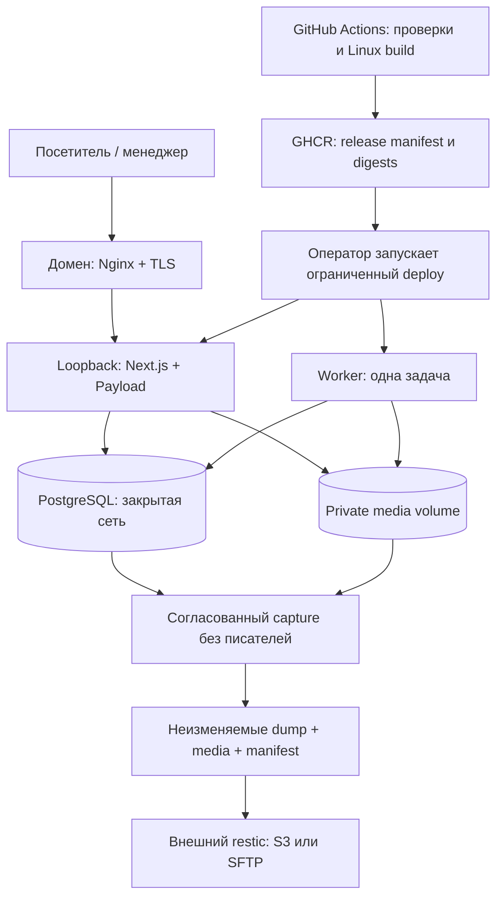
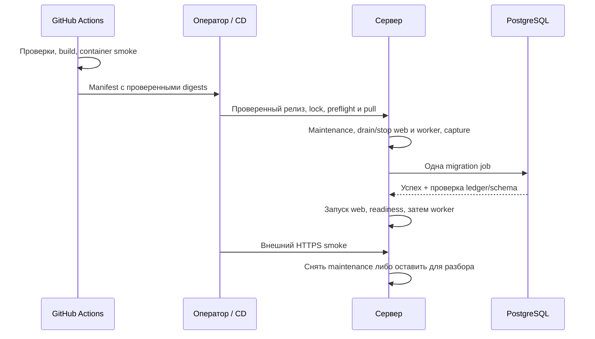
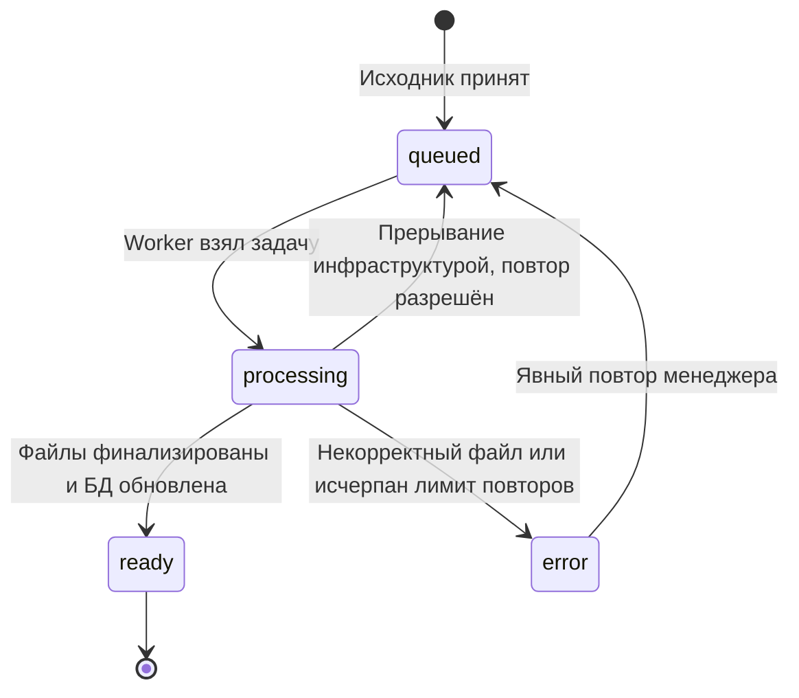

# Экономное развёртывание ПромФормаТех на VPS с доменом - Plan

## Goal Capsule

**Цель:** менеджер работает с сайтом по защищённому адресу на недорогом VPS, а владелец может обновить сайт и восстановить его после потери сервера без потери данных сверх выбранного интервала резервирования.

**Способ:** сборка в GitHub Actions, поставка готовых Docker-образов через GHCR, Next.js + Payload + PostgreSQL на одном сервере, Nginx и сертификат домена; решения KTD1–KTD9.

**Основание:** запрос владельца и его уточнение: Ubuntu, 2 vCPU, 4 ГБ RAM, около 80 ГБ диска; сервер и домен ещё не куплены, место внешних копий не выбрано.

**Граница текущей работы:** подготовка плана. Реализация, платные покупки, изменение DNS и выкат этим документом не выполняются. Локальную рабочую базу не использовать для испытаний.

**Статус исполнения 23.10.2026:** по отдельному поручению владельца подготовлена кодовая часть U1–U4 до инфраструктуры. [Отчёт, проверки и оставшиеся критерии](../reviews/pre-infrastructure-readiness.md); [runtime](../deployment/runtime.md), [перенос данных](../deployment/data-migration.md). U5–U9 не выполнены; полный Definition of Done не закрыт. Исходный контракт ниже сохранён.

**Условия остановки выката:** не пройдены перенос данных, ресурсная приёмка, внешняя копия с восстановлением или проверка HTTPS; обнаружены несовместимость схемы/образов либо доступ гостя к черновикам. Исполнитель сохраняет доказательства и не открывает стенд при непроверенной сохранности данных.

---

## Product Contract

### Summary

Подготовить приложение и инфраструктуру для одного VPS с доменом, начиная с закрытого тестирования менеджером и заканчивая публичным запуском.
Обновления кода поступают готовыми образами; изменения контента публикуются из CMS без пересборки приложения.

### Problem Frame

Сейчас приложение работает локально, но production-инфраструктура отсутствует.
Сборка и перекодирование видео создают нагрузку, которую нельзя смешивать с постоянной стоимостью обслуживания сайта.
Владелец хочет небольшой сервер, понятный порядок выпуска обновлений и возможность восстановить сайт на другом хосте.

### Requirements

**Ресурсы и поставка**

- R1. Основной целевой сервер: Ubuntu LTS, 2 vCPU / 4 ГБ RAM / примерно 80 ГБ SSD; достаточность подтверждается production-испытанием, а не обещанием по конфигурации.
- R2. Проверки, установка зависимостей и сборка релиза выполняются на GitHub-hosted runner; VPS скачивает и запускает готовые образы.
- R3. Выкат сохраняет PostgreSQL, оригиналы, производные медиа и секреты между заменами контейнеров; каждый релиз имеет фиксированную версию и проверенный путь отката.

**Контент и менеджер**

- R4. Сохраняются Next.js + Payload, текущий интерфейс, роли, черновики, версии, предпросмотр, публикация и заявки.
- R5. Загрузка медиа не держит целиком большой HTTP-файл в памяти; обработка ограничена и не блокирует запрос публикации.
- R6. Неизменённый оригинал сохраняется; подходящие видео обходятся без повторного кодирования. Сжатие с потерями не объявляется математически без потерь.
- R7. Перезапуск и выкат не теряют принятый исходник или задачу обработки; менеджер видит итог либо понятную ошибку с возможностью повтора.

**Доступ и эксплуатация**

- R8. Домен работает через Nginx и HTTPS с автоматическим продлением сертификата; прямой внешний доступ к PostgreSQL и Node закрыт.
- R9. Прокси и кеши сохраняют разграничение доступа: черновики и оригиналы недоступны гостю, снятие публикации закрывает последующие запросы к медиа.
- R10. Существует согласованная внешняя копия базы, медиа и конфигурации; восстановление проверено на отдельном окружении.
- R11. Есть инструкция первого запуска, обновления, отката и восстановления после потери VPS, а также наблюдение за доступностью, ресурсами, очередью, сертификатом и копиями.
- R12. Закрытая приёмка менеджером предшествует публичному открытию; ограничения индексации не считаются контролем доступа.

### Scope Boundaries

Включены необходимые изменения кода, миграции, Docker, CI/CD, Nginx, TLS, перенос наполнения, резервирование, инструкции и приёмка.
Почтовый сервер, Redis, Kubernetes, несколько реплик, CDN, новый UI и смена фреймворка не входят в этот запуск: текущая очередь уже хранится в PostgreSQL, а ожидаемая нагрузка мала.
SMTP-провайдер можно подключить позже; заявки сохраняются в CMS и без отправки писем. До подключения почты нужна операторская процедура восстановления доступа.
Вынос медиаворкера или файлов в отдельный сервис — последующая работа только при подтверждённом дефиците ресурсов.
Объёмный DDoS требует защиты сети у хостера; Nginx и лимиты приложения защищают только доступную им часть нагрузки.

### Acceptance Examples

- AE1. Менеджер сохраняет черновик и смотрит его через HTTPS-preview; посетитель продолжает видеть опубликованную версию. После публикации посетитель видит изменения без CI-сборки.
- AE2. Во время обработки видео выполняется обновление приложения; после запуска нового worker задача завершается либо остаётся в явном состоянии для ограниченного повтора, исходник не исчезает.
- AE3. Потерян VPS; на новом сервере восстанавливаются последняя согласованная копия и соответствующий релиз, проверяются аккаунты, версии, заявки и медиа.
- AE4. Новый релиз не прошёл проверку готовности; сайт остаётся в обслуживании или возвращается на совместимый предыдущий релиз, автоматическое восстановление старых данных не выполняется.

---

## Planning Contract

### Evidence

Проверены исходники и установленные зависимости; production-нагрузка в рамках подготовки плана не запускалась.

| Текущее место | Вывод для реализации |
|---|---|
| `app/compose.yaml`, `app/next.config.ts` | Есть только dev PostgreSQL; нет production Compose, Dockerfile и standalone-поставки. |
| `app/src/payload.config.ts` | Production schema push выключен, файлов миграций нет; upload ограничен размером файла, пул БД не настроен под роли процессов. |
| `app/src/cms/hooks/media.ts`, `app/src/features/media/storage.ts` | Оригинал сохраняется из `req.file.data`; включить только `useTempFiles` нельзя — это даст пустой буфер вместо содержимого. |
| Payload 3.91, `uploads/fetchAPI-multipart` | Есть потоковый parser с backpressure и temp-file режимом; отдельный default `requestSizeLimit` равен 50 MiB, хотя приложение заявляет 500 MiB на файл. |
| `app/src/features/media/process-video.ts` | Сначала всегда выполняется encode, затем иногда remux; выбор стратегии надо перенести перед encode. |
| `app/src/cms/scripts/worker.ts`, `app/src/cms/tasks/process-media.ts` | SIGTERM останавливает FFmpeg; обработчик может вернуть `success: false` как завершённую задачу. Нужна явная семантика прерывания и повторного запуска. |
| `app/src/cms/jobs/worker-lock.ts` | Advisory lock удерживает отдельное соединение; worker pool нельзя уменьшать до одного соединения. |
| `app/src/app/sitemap.ts`, `app/src/app/robots.ts` | Проверить runtime-границу БД и адреса домена, исключить чтение production-контента при сборке. |
| `app/src/features/content/cache.ts`, `app/src/features/media/ResponsiveImage.tsx` | Кеш опубликованных чтений и готовые варианты `next/image` уже есть; повторная оптимизация через Next Image не нужна. |
| `app/src/app/(payload)/media/[id]/[variant]/route.ts` | Медиа проходят авторизацию и отдаются потоково с Range; публичный alias на каталог файлов нарушит контракт. |

### Key Technical Decisions

- KTD1. **Сохраняем единое приложение Next.js + Payload.** Статический экспорт потребовал бы отдельного CMS-бэкенда и усложнил preview без устранения его стоимости. (session-settled: user-directed — chosen over TanStack migration: владелец отказался от переезда и продолжил Next.js.) Governs R4.
- KTD2. **GitHub Actions собирает релиз, GHCR хранит образы, сервер делает pull по digest.** Никаких build/install/test на VPS; контент не входит в image и не проходит через CI. Web — standalone, worker/migrator — отдельный runtime target с необходимыми CLI-зависимостями. Общий release manifest связывает оба digest и commit. Governs R2–R3.
- KTD3. **Один VPS, host Nginx и Certbot, контейнеры web/worker/PostgreSQL.** Web публикует порт только на loopback; PostgreSQL не публикует порт хоста. Один non-root UID/GID web и worker получает доступ к постоянному media volume. Сохраняем отдельный постоянно работающий worker на 4 ГБ; запуск по расписанию не вводим без доказанной выгоды. Governs R1, R7–R9.
- KTD4. **Используем штатный temp-file parser Payload.** Сохранение оригинала принимает доверенный серверный путь либо буфер Local API; файл копируется в private staging и атомарно финализируется. Payload сохраняет владение своим temp-файлом и его очисткой. Nginx upload buffering сначала оставляем на диске, response buffering отключаем для Next streaming; это разные настройки. Governs R5, R9.
- KTD5. **Выбор remux/encode делается до обработки, очередь остаётся последовательной.** Проверяем кодеки, геометрию, ориентацию, frame rate и битрейт; одного расширения MP4 недостаточно. На остановке worker прекращает брать задачи, ограниченно ждёт текущую и безопасно возвращает прерванную в очередь. Ошибочный файл не повторяется бесконечно; SMTP не получает обещание exactly-once. Governs R6–R7.
- KTD6. **Production начинается с новой БД и initial migration.** Для существующего наполнения используем проверенный data-only импорт в эту схему с сохранением ID, отношений, версий, globals, media keys и последовательностей. Dev migration ledger не импортируется. Initial migration поверх восстановленного dev dump и удаление его `batch: -1` вслепую запрещены. Governs R3–R4.
- KTD7. **Один канонический HTTPS-домен и контролируемая цепочка proxy.** Nginx перезаписывает клиентские forwarding-заголовки, приложение доверяет только закрытому origin-прокси. Нет общего proxy cache для CMS/preview/media, нет публичного alias private volume. CDN в первой версии отсутствует. Governs R8–R9.
- KTD8. **Внешние зашифрованные копии через restic.** Основной рекомендуемый backend — S3-compatible у другого провайдера/аккаунта; альтернатива — SFTP на независимый сервер. До запуска выбирается один. База и файловый снимок захватываются в одном окне без писателей; выгрузка идёт из неизменяемого staging после возобновления сайта. Governs R10.
- KTD9. **Последовательный выкат с коротким окном обслуживания.** На небольшом сервере не держим два полноценных стека ради zero-downtime. Общая блокировка исключает одновременные deploy/migration/backup-capture; предыдущие образы сохраняются. Откат кода допустим только при совместимости текущей схемы, восстановление данных — отдельная осознанная операция. Governs R3, R11.

### Assumptions

Рабочая база планирования — выделенный VPS без чужих сайтов, Ubuntu 24.04 LTS, Linux amd64; фактическую ОС и архитектуру подтвердить перед сборкой релиза. Другую поддерживаемую Ubuntu LTS можно использовать после проверки совместимости инструкции.
Каноническое имя, наличие `www`, email для сертификата, провайдер, SSH-пользователь и параметры backup остаются подстановками до покупки.
Предлагаемые эксплуатационные цели: ежедневная внешняя копия и перед миграциями, RPO до 24 часов, целевой RTO до 4 часов после получения нового VPS. Время восстановления проверяется репетицией, это не SLA.
Начальная retention-политика: 7 ежедневных, 4 еженедельных и 3 ежемесячных копии; подтвердить стоимость после оценки медиатеки.
Начальные ресурсные цели и тестовая нагрузка в Verification Contract — инженерные критерии, которые уточняются по измерениям, без скрытого снижения разрешённых размеров файлов.

### High-Level Technical Design

### Configuration Baseline

| Область | Настройка и ограничение |
|---|---|
| Runtime | Сохраняем закреплённые Node/pnpm/Next/Payload/PostgreSQL; обновление версий — отдельное решение. Production `NODE_ENV`, canonical `SERVER_URL`, постоянный `PAYLOAD_SECRET`. |
| Стартовый бюджет RAM | Для первого замера: web до 1280 MiB, worker вместе с FFmpeg до 1024 MiB, PostgreSQL до 512 MiB; остаток — ОС, Nginx, служебные операции и запас. Это гипотеза, не гарантия и не настройка heap. |
| CPU и очередь | Одна media job и один encoder thread уже предусмотрены. Контейнер worker получает ограничение CPU; итоговый timeout подтверждается на допустимом 4K/15-минутном входе. |
| PostgreSQL | Отдельные небольшие пулы web/worker, запас соединений для advisory lock и транзакций; исходный ориентир pool max 5 на процесс, max_connections 30, shared_buffers 128 MiB. Подтвердить нагрузкой; runtime-роль не superuser. |
| Upload | Лимит файла 500 MiB сохраняется; один файл на multipart, конечные лимиты полей и полного request с запасом на metadata. Согласовать Nginx, Payload, UI и тесты. Bulk upload — несколько запросов, его параллельность контролируется отдельно. |
| Таймауты | Upload idle timeout и допустимая длительность передачи отличаются от времени FFmpeg. HTTP upload возвращает результат приёма/очереди и не ждёт перекодирования. |
| Диск | Отдельные persistent пути для БД, media, Next cache и backup staging; временные файлы на диске, не tmpfs. Не включать media/secrets в image. |
| Ёмкость 80 ГБ | Считать ОС, два релиза, DB/WAL, оригиналы+производные, upload/transcode temp и вторую файловую копию для staging. Предупреждать при свободном месте менее 20%; preflight сравнивает размер операции с фактическим запасом. |
| Сеть | Внешние 80/443; SSH ограничен там, где это позволяет доступ оператора. Node loopback, DB private. Не полагаться только на UFW: публикация Docker-портов требует отдельной проверки. |
| Секреты | Runtime-файл вне Git с ограниченными правами; секреты не передаются build args и не попадают в image, логи, тестовые артефакты или команды в истории. |

---

## Implementation Units

### U1. Runtime-конфигурация, сборка без production DB и здоровье приложения

**Цель / требования:** отделить выпуск кода от данных и обеспечить проверяемый запуск; R1–R3, R8, R11. **Зависимости:** нет.

**Файлы:** `app/next.config.ts`, `app/src/payload.config.ts`, `app/src/app/sitemap.ts`, `app/src/app/robots.ts`, `app/src/lib/urls.ts`, `app/src/config/runtime.ts` (новый), `app/src/app/api/health/live/route.ts` и `ready/route.ts` (новые), `app/.env.example`, `app/tests/unit/runtime.test.ts`, `app/tests/integration/health.test.ts` (новые).

**Подход:** KTD2, KTD7. Конфигурация проверяет runtime secrets и HTTPS-origin; CI использует только несекретные compile-time значения, недоступную БД и отключённую SMTP. Sitemap и адреса сайта читаются в runtime, сборка не запекает чужой домен или контент. Liveness лёгкий; readiness с ограниченным временем проверяет БД и соответствие миграций. Проверку записи в media выполнять при старте, не тяжёлым HTTP healthcheck.

**Проверки:** build с недоступной БД; один образ с двумя тестовыми runtime-доменами выдаёт правильные canonical/robots/preview; отсутствие secret в слоях; DB недоступна — readiness 503 без подробностей; health-route не требует CMS-login.

**Готово:** образ воспроизводимо собирается вне сервера, реальные данные не нужны до запуска, health-контракт проверен.

### U2. Приём больших файлов с ограниченной памятью

**Цель / требования:** устранить полные HTTP upload-буферы, сохранив права и исходники; R5, R9. **Зависимости:** U1.

**Файлы:** `app/src/payload.config.ts`, `app/src/config/media.ts`, `app/src/cms/hooks/media.ts`, `app/src/features/media/storage.ts`, новые небольшие модули источника файла/атомарного сохранения/очистки; `app/tests/media/upload-storage.test.ts`, `app/tests/integration/media-upload.test.ts` (новые), `app/tests/e2e/admin-media.spec.ts`.

**Подход:** KTD4. Использовать `tempFilePath` штатного parser, не повторно читать файл целиком. Buffer-путь оставить для seed/Local API. Не доверять пути из клиентских полей; имя исходника генерирует сервер. Согласовать request/file/field limits, пути temp, cleanup и ограничение bulk-параллельности. Ошибка после сохранения файла, но до записи БД не оставляет бесконтрольные orphan-файлы.

**Проверки:** одинаковые байты исходника для HTTP temp и Local API; приём у лимита/отказ сверх него; большой multipart и лишние файлы/поля; отмена, таймаут, полный диск, ошибка БД; несколько bulk-загрузок; temp не доступен HTTP и очищается; фактический пик RAM измеряется по cgroup, а не только JS heap.

**Готово:** менеджер загружает допустимый файл без линейного роста памяти на его полный размер, ошибки не повреждают публикации.

### U3. Экономная обработка и безопасная остановка worker

**Цель / требования:** сократить CPU и сохранить очередь при обновлении; R6–R7. **Зависимости:** U2.

**Файлы:** `app/src/features/media/process-video.ts`, `process-command.ts`, новые `video-probe.ts`/`video-policy.ts`/`video-transcode.ts`, `app/src/cms/scripts/worker.ts`, `app/src/cms/tasks/process-media.ts`, `app/src/cms/jobs/worker-lock.ts`, `app/src/config/jobs.ts`; `app/tests/unit/video-policy.test.ts`, `app/tests/integration/worker-lifecycle.test.ts` (новые), `app/tests/media/processors.test.ts`.

**Подход:** KTD5. Сначала характеризующие тесты текущего сохранения и доступа, затем декомпозиция. Определить ограниченные повторы transient/interrupted задач, отдельно окончательный bad input. Не считать return `success:false` эквивалентом retry Payload. Сохранить atomic derivatives, взаимное исключение worker и обработку дочерних процессов. Не усложнять очередь отдельным брокером.

**Проверки:** совместимый небольшой H.264 remux без encode; несовместимое/слишком тяжёлое видео encode; ориентация, нечётные размеры, файл без аудио, повреждённый поток; SIGTERM и аварийный kill на разных стадиях; crash после финализации до DB-update; второй worker не дублирует задачу; ошибка видна менеджеру; heartbeat не объявляет длинное разрешённое видео зависшим.

**Готово:** AE2 пройден; допустимый тяжёлый ролик обрабатывается в согласованном времени без влияния на доступность сайта.

### U4. Миграции и перенос существующего наполнения

**Цель / требования:** воспроизводимая схема и проверенный перенос данных; R3–R4, R10. **Зависимости:** U1–U3, схемы окончательно определены.

**Файлы:** `app/src/migrations/` (новые миграции и при необходимости helpers/SQL assets), `app/src/payload.config.ts`, `app/package.json`, `app/src/cms/scripts/create-owner.ts`; `app/scripts/operations/import-content.*`, `app/tests/integration/migrations.test.ts` (новые), `docs/deployment/data-migration.md` (новый).

**Подход:** KTD6. На изолированной копии сравнить schema fresh migration и schema текущего dev-снимка, подготовить явный состав data-only переноса. Исключить dev migration ledger и неприменимое временное состояние; сохранить полезные версии, пользователей, связи и media keys. Проверить FK, последовательности и допустимые статусы очереди. При несовпадении схемы остановиться и подготовить явное преобразование данных; не отмечать миграцию выполненной вручную. У initial migration нет права разрушать existing DB.

**Проверки:** пустая DB → migration → owner; повторный migrate без изменений; импорт заполненного снимка → связи, версии, пользователь и media checksum совпадают; следующий ID не конфликтует; неверная схема отвергается; незавершённые jobs восстанавливаются; проверяется migration ledger, а не только exit code CLI.

**Готово:** rehearsal переноса повторён на временной БД; есть сохранённый исходный snapshot и документированный источник production-контента. Seed не вызывается при каждом деплое.

### U5. Production Docker-поставка

**Цель / требования:** готовые небольшие образы и сохранность runtime-данных; R1–R3, R7. **Зависимости:** U1–U4.

**Файлы:** `app/Dockerfile`, `app/.dockerignore`, `deploy/compose.production.yaml`, `deploy/env.production.example`, `deploy/postgres/` (новые), `app/package.json`; `app/tests/deployment/container-smoke.*` и `docs/deployment/runtime.md` (новые).

**Подход:** KTD2–KTD3. Multi-stage Linux build, standalone web с `.next/static` и нужными public assets; явный runtime для worker/migrate/admin CLI. Native Sharp и FFmpeg соответствуют Linux/архитектуре сервера. Init, stop grace, restart, healthchecks, ограничение CPU/RAM и логов; никаких privileged-контейнеров и Docker socket. У migrator отдельная роль с DDL, у приложения права DML/последовательностей, у bootstrap PG superuser доступ только операторский.

**Проверки:** только образы+env+volumes запускают весь стек; CLI/migrations не требуют devDependencies на хосте; web/worker читают файлы mode0600 под согласованным UID; reboot/recreate сохраняют данные; health показывает фактическую готовность; остановка обработчика сохраняет очередь; DB и backend недоступны извне.

**Готово:** установленный Docker способен запустить релиз без исходников, Node и сборщика на VPS.

### U6. GitHub Actions, GHCR и управляемый CD

**Цель / требования:** воспроизводимый выпуск и ограниченный канал выката; R2–R3, R11. **Зависимости:** U5; end-to-end CD проверяется после U7–U8.

**Файлы:** `.github/workflows/ci.yml`, `release.yml`, `deploy.yml`, `deploy/scripts/deploy-release.*`, `deploy/scripts/release-manifest.*`, `app/tests/deployment/release-contract.*` и `docs/deployment/ci-cd.md` (новые).

**Подход:** PR → lockfile install/проверки/изолированная PostgreSQL/тесты; доверенный commit → Linux images/container smoke → GHCR manifest. Все actions закреплены на проверенных SHA, permissions минимальны, production secrets отсутствуют в PR jobs; не выполнять fork-код через привилегированный `pull_request_target`. Cache не содержит env/media/DB. Первый CD — ручной запуск выбранного проверенного релиза; GitHub Environment approvals использовать, если доступны на тарифе.

На VPS root-owned deploy wrapper принимает только allowlisted repository и digest/проверенный manifest, не произвольные команды/Compose/env. Deploy user не входит в группу Docker, не может менять wrapper/конфигурацию. Host key SSH закреплён заранее; private GHCR pull использует отдельный read-only credential. Общий deploy lock, отмена workflow не обрывает начатую миграцию; серверная операция имеет идентификатор, журнал и проверяемый результат после разрыва SSH.

**Проверки:** PR без секретов; release для непроверенного commit не допускается; digest web/worker совпадает с manifest; подмена repo/аргумента/SSH key отвергается; два deploy не пересекаются; разрыв SSH не оставляет неучтённую операцию; ошибка migration не запускает web; неправильный health не вызывает восстановление старой DB.

**Готово:** тестовый сервер обновляется выбранным артефактом без сборки; журнал содержит предыдущий/новый release, результат migration и smoke без секретов.

### U7. Ubuntu, домен, Nginx и сертификат

**Цель / требования:** защищённый доступ по домену; R8–R9, R12. **Зависимости:** U5; настройки адреса согласованы с U1.

**Файлы:** `deploy/nginx/` (HTTP bootstrap, TLS site, maintenance), `deploy/systemd/` (служебные timers по мере необходимости), `app/tests/deployment/proxy-smoke.*`, `docs/deployment/server-bootstrap.md` (новые).

**Подход:** KTD3, KTD7. Подготовить SSH по ключам, обновления безопасности, Docker Engine/Compose plugin, host Nginx/Certbot, ограниченный deploy user и каталоги. Сначала проверить второй SSH-сеанс и консоль провайдера, затем ужесточать доступ. Согласовать firewall и реальные опубликованные Docker-порты; не трогать существующие чужие сайты, если VPS окажется общим.

DNS: A на IPv4, AAAA только при рабочем IPv6; `www` только если выбран. Nginx HTTP обслуживает ACME challenge, затем Certbot получает сертификат для реально настроенных имён. После проверки TLS включается redirect к одному HTTPS-origin. ACME renewal через systemd timer, deploy hook проверяет конфигурацию и перезагружает Nginx. HSTS включать после подтверждённого HTTPS, без preload/includeSubDomains до отдельной проверки.

Прокси сохраняет Host, задаёт HTTPS scheme и перезаписывает X-Real-IP/forwarded headers; runtime включает TRUST_PROXY_HEADERS только с закрытым origin. Next streaming не буферизуется ответом, upload body может буферизоваться на диске. Конечные body/time/concurrency limits проверяются с CMS bulk-upload; login/lead rate limits не применяются одинаково к каждому admin asset. Preview iframe разрешён для собственного origin, защитные заголовки не ломают Payload/Next.

**Проверки:** HTTPS цепочка/имена/redirect без циклов; renewal dry-run; неверный Host; spoofed IP; невозможность доступа к 3000/5432 снаружи; guest drafts/originals; Range/HEAD/416; форма заявки, login и preview через proxy; медленная/большая загрузка; skeleton/streaming; доступ к ACME при maintenance.

**Готово:** AE1 пройден через настоящий HTTPS-origin, сертификат продлевается автоматически, внешний скан открытых портов соответствует плану.

### U8. Внешний backup, restore и наблюдение

**Цель / требования:** восстановление и обнаружение сбоев; R10–R11. **Зависимости:** U3–U5, до открытия доступа требуется выбранный backend копий.

**Файлы:** `deploy/scripts/backup.*`, `restore.*`, `monitor.*`, `deploy/systemd/`, `app/tests/deployment/restore-smoke.*`, `docs/deployment/backup-restore.md`, `incident-runbook.md` (новые).

**Подход:** KTD8–KTD9. Подготовить staging media заранее; затем maintenance, остановить новых писателей, завершить/отменить in-flight операции с согласованным состоянием, остановить web/worker, выполнить финальную синхронизацию media и логический dump PG в одном стабильном окне. Присоединить release/schema/media inventory manifest. После завершённого локального capture запустить сервисы, выгрузить неподвижный staging через restic. Следующий capture не изменяет staging до окончания предыдущей выгрузки. Физический live PG volume не архивируется вместо dump.

Ключ восстановления restic и реквизиты доступа хранятся вне VPS; необходимые runtime secrets входят в защищённый набор. Политика удаления копий отдельна от обычной записи, насколько позволяет backend. Если вторая media-копия не помещается, остановить capture: требуется проверяемый filesystem snapshot либо увеличение диска/другое окно обслуживания, а не несогласованная копия без freeze.

Наблюдение без тяжёлого monitoring-стека: внешний HTTPS uptime, память/OOM/restart, диск и inode, возраст очереди/worker heartbeat, дата последней успешной внешней копии, истечение TLS. Назначить получателя уведомлений и реально проверить доставку; успешный локальный dump не равен внешней копии. Backup/prune запускаются с низким приоритетом вне media-пиков, учитываются в общем ресурсе сервера.

**Проверки:** во время capture нет писателей; отказ offsite не отмечается успехом; неполный backup отвергается; ошибки/предупреждения restic учитываются; восстановление на отдельную DB/media → аккаунты/черновики/заявки/связи/медиа/очередь; потеря VPS моделируется из offsite без чтения исходного диска; измерить время и место capture/restore.

**Готово:** AE3 пройден, указаны реальные RPO/RTO и длительность обслуживания, оператор получил тестовое уведомление о сбое.

### U9. Ресурсная приёмка, первый выкат и передача менеджеру

**Цель / требования:** доказать пригодность выбранного VPS и завершить полный путь запуска; R1–R12. **Зависимости:** U1–U8.

**Файлы:** `app/tests/deployment/resource-scenarios.*`, `release-smoke.*`, `docs/deployment/rollout.md`, `docs/reviews/deployment-acceptance.md` (новые), `app/README.md`, `docs/implementation-status.md`, `docs/admin/manager-guide.md`.

**Подход:** production-сборка и реальные ограничения Linux, отдельная тестовая DB/media. Проверить Verification Contract, зафиксировать размер образов, RAM/CPU/диск и время обработки. Уточнять лимиты по доказательствам, не скрывать OOM увеличением swap. Затем выполнить Rollout Sequence, передать менеджеру адрес/роль/инструкцию, собрать обратную связь; публичное открытие — отдельный проверенный шаг.

**Проверки:** обновление с предыдущего релиза, restart/reboot, backup под работающим сайтом после capture, совместимый rollback и сценарий несовместимой миграции без автоматического restore; полный цикл менеджера на desktop/mobile; публикация не запускает workflow.

**Готово:** AE1–AE4 и ресурсные критерии подтверждены протоколом; ограничения честно перечислены, экспериментальный код удалён.

---

## Rollout Sequence

Это порядок работ и контрольных точек. Исполняемые команды и конфиги создаются в U5–U8 после проверки конкретного сервера; здесь нет секретов и команд для слепого запуска.

1. **Выбрать площадку:** подтвердить 2 vCPU/4 ГБ/80 ГБ, полноценный Docker, публичный IP, SSH/консоль, защиту сети, возможность увеличить диск/RAM; выбрать домен и backend внешних копий. Уточнить, действительно ли сервер выделен только под этот сайт.
2. **Подготовить код:** U1–U4, включая исправление upload и остановки worker; выполнить migration rehearsal на копии данных. Подготовить согласованный снимок одобренного наполнения, не E2E-базу.
3. **Подготовить выпуск:** U5–U6, CI на Linux, проверенный manifest с digests. Настроить доступ VPS к GHCR и ограниченный CD-канал. Первую серверную установку выполнить оператором из той же поставки.
4. **Подготовить Ubuntu:** обновления, время, SSH и резервный доступ, firewall, Docker/Compose, Nginx, Certbot, restic, пользователи, права каталогов, ротация логов. Проверить IPv4/IPv6 и отсутствие лишних внешних портов.
5. **Настроить домен:** DNS, HTTP ACME site, выпустить сертификат, проверить цепочку, затем HTTPS/redirect и renewal timer. До готовности приложения показывать maintenance, не открытую пустую CMS.
6. **Передать runtime-настройки:** production secrets, canonical SERVER_URL, private DB credentials, media/cache paths, GHCR pull, backup credentials. Владельца создавать через CLI только если он отсутствует; пароли не передавать в командной строке или Git.
7. **Развернуть данные:** запустить PostgreSQL, initial migration, проверенный data-only импорт и media snapshot; проверить ledger/FK/sequences/checksums. Применить права runtime-ролей. Не выполнять seed поверх пользовательского содержимого.
8. **Запустить web и worker:** readiness, lock/heartbeat, права файлов, ресурсы, журнал ошибок. Пока доступ имеет оператор, индексация запрещена. Для закрытого браузерного стенда использовать Basic Auth Nginx: после проверки не передавать Basic Authorization приложению, CMS использует собственные session cookies. Проверить cookie-login, preview и REST из браузера; внешние token-only API-клиенты не обходят этот gate. Это временная конфигурация стенда, не новая роль CMS; после публичного открытия штатный Authorization передаётся приложению.
9. **Пройти техническую приёмку:** оператор проверяет реальные HTTPS, медиа и публикацию, мобильный браузер, повторный deploy, reboot, renewal dry-run и ограниченную нагрузку. Получить действующую внешнюю копию и провести restore на отдельном окружении до передачи рабочих доступов менеджеру.
10. **Передать менеджеру:** после технической приёмки выдать персональную роль manager и закрытый доступ, провести AE1 с менеджером, предоставить инструкцию загрузки/черновика/preview/publish/retry и канал замечаний. Доступы передаются безопасным способом вне репозитория.
11. **Открыть публично:** согласовать фактический контент и контакты, подготовить и опубликовать privacy, проверить приём заявок; снять временный access gate и глобальный noindex только после решения владельца. Настройки личных `seo.noIndex` сохранить. Проверить robots/sitemap/canonical, доступ гостя и штатную Bearer-авторизацию API заново.
12. **Наблюдать после запуска:** проверить логи/очередь/ресурсы после первой нагрузки и следующей ночной копии. Зафиксировать принятую конфигурацию, ответственного, расположение ключа восстановления и предыдущий релиз.

### Subsequent Releases and Rollback

Оператор выбирает проверенный release manifest; wrapper проверяет lock, место, текущую версию, доступность копий и совместимость схемы, заранее скачивает образы.
Перед миграцией выполняется согласованная копия с подтверждённой внешней выгрузкой; несовместимые изменения схемы не допускаются без отдельного плана восстановления.
В maintenance останавливаются писатели, migration выполняется один раз, затем web readiness, worker и внешние smoke; лишь после этого снимается обслуживание.
Предыдущий web/worker digest можно вернуть только при доказанной совместимости с текущей БД и медиа.
При несовместимости — сохранить аварийное состояние, оценить новые записи после snapshot и отдельно решить восстановление: автоматический откат базы при ошибке health недопустим.
Обновление major PostgreSQL и смена архитектуры CPU не маскируются под обычный deploy.

---

## Verification Contract

Тестовые данные изолированы от рабочей локальной и production-базы. Использовать реальные PostgreSQL, Sharp и FFmpeg там, где mocks не доказывают поведение.

| Проверка | Доказательство |
|---|---|
| `pnpm check` | Типы, Biome, CSS/tokens, unit-проверки и лимит 300 строк проходят. Константы, типизированные тексты и декомпозиция сохраняются. |
| `pnpm test:media` | Encode/remux, неизменность оригиналов, корректные производные и ошибки. |
| `pnpm test:e2e` | Менеджер, черновики/preview/publish, гости, заявки, медиа и существующая адаптивность без регрессий. |
| Новые integration/deployment scripts | Реальные upload/worker/migrations/health/containers; команды добавляются в package scripts и документацию. |
| Production Linux build | Без доступной production DB и секретов; Linux native dependencies, отдельно web и worker/CLI smoke. |
| Proxy/TLS smoke | Настоящий HTTPS-origin, cookie/CSRF/preview/streaming/Range, limits, renewal, закрытые порты и оригиналы. |
| Restore drill | Отдельный сервер/окружение восстановлено исключительно из offsite-набора и manifest; данные/права/версии сверены. |

Предлагаемый профиль нагрузки: 10 одновременных анонимных сессий, 2 менеджера, две загрузки и одна media job; не менее 30 минут, отдельно самый тяжёлый разрешённый ролик и 60 минут после обработки для обнаружения удержания памяти.
Первичный критерий для 4 ГБ: нет OOM/restart, нет устойчивого swap thrashing, доступно не менее 512 MiB памяти хоста при устойчивой нагрузке; краткие пики отдельно фиксируются.
Сравнить baseline и изменения по общему cgroup memory peak, RSS процессов, CPU time FFmpeg, длительности upload/обработки, активным соединениям PG и свободному диску. Dev-server не используется как production-baseline.
Предлагаемая цель тёплого серверного p95: до 1 секунды для публичных страниц, до 2 секунд для обычных CMS-чтений/сохранений без передачи большого файла. Отдельно измерить внешнюю сеть, холодный запуск и поиск.
Если цель не достигается, определить узкое место и исправить либо пересогласовать ресурс/лимит; нельзя молча уменьшить 500 MiB/15 минут или объявить успешной только лёгкую нагрузку.
По каждому release сохраняются commit/digests, тестовый профиль, результаты, migration compatibility, backup identifier и границы доказательства.

---

## Definition of Done

- Исходники содержат проверенные миграции, упаковку и CI/CD; сервер не выполняет сборку приложения.
- Менеджер работает на реальном HTTPS-домене, черновики не утекли, публикация не требует CI.
- Оригиналы и очередь переживают выкат, образы воспроизводимы, секреты и медиа не включены в поставку.
- Целевой VPS прошёл измерения, Nginx/TLS/renewal и persistence прошли проверки.
- Внешний backup восстановлен на отдельном окружении; оператор знает порядок совместимого rollback и полного восстановления.
- Созданы и проверены инструкции U4–U9, назначен получатель оповещений, временные эксперименты убраны.
- Отдельно зафиксировано: «готов к закрытой приёмке» или «открыт публично». Одно не подменяет другое.

### Open Questions and Gates

Для начала доработок кода дополнительных ответов не требуется.
До серверного этапа нужны фактические VPS/ОС/архитектура, IP, домен/`www`, email сертификата, способ защищённого доступа и подтверждение отсутствия чужих сервисов.
До подключения резервирования выбрать S3 или SFTP, место хранения recovery key и получателя уведомлений; без этого публичный запуск не готов.
Перенос наполнения блокируется до доказанного schema parity/rehearsal U4. Объём данных, окончательные memory/time limits и длительность обслуживания определяются измерениями U9.
Публичный приём заявок блокируется до заполнения privacy и подтверждения контента владельцем; почтовый сервер не требуется для закрытой проверки менеджером.

---

## Sources

- [Next.js self-hosting](https://nextjs.org/docs/app/guides/self-hosting): proxy, streaming и самостоятельное размещение.
- [Next.js standalone output](https://nextjs.org/docs/app/api-reference/config/next-config-js/output): границы файловой трассировки.
- [Payload uploads](https://payloadcms.com/docs/upload/overview): temp files и upload options; точное поведение сверено с установленной 3.91.0.
- [Payload migrations](https://payloadcms.com/docs/database/migrations): production schema lifecycle; dev-marker проверен в установленном drizzle adapter.
- [GitHub Docker publishing](https://docs.github.com/en/actions/tutorials/publish-packages/publish-docker-images) и [secure use](https://docs.github.com/en/actions/reference/security/secure-use): release pipeline и permissions.
- [GHCR](https://docs.github.com/en/packages/working-with-a-github-packages-registry/working-with-the-container-registry): image digests и read-only pull.
- [Docker firewall](https://docs.docker.com/engine/network/packet-filtering-firewalls/) и [Compose startup order](https://docs.docker.com/compose/how-tos/startup-order/): сеть и readiness.
- [Nginx proxy](https://nginx.org/en/docs/http/ngx_http_proxy_module.html): headers, buffering и timeouts.
- [Certbot](https://eff-certbot.readthedocs.io/en/stable/using.html#renewing-certificates): renewal и deploy hooks.
- [PostgreSQL 17 dump](https://www.postgresql.org/docs/17/backup-dump.html): логические копии и восстановление.
- [Restic backends](https://restic.readthedocs.io/en/stable/030_preparing_a_new_repo.html) и [backup](https://restic.readthedocs.io/en/stable/040_backup.html): S3/SFTP, консистентность файлов и проверки.
- Проектные ориентиры: `app/AGENTS.md`, `app/README.md`, `docs/architecture/application-structure.md`, `docs/admin/verification.md`; существующие проверки расширять, не подменять макетами.
